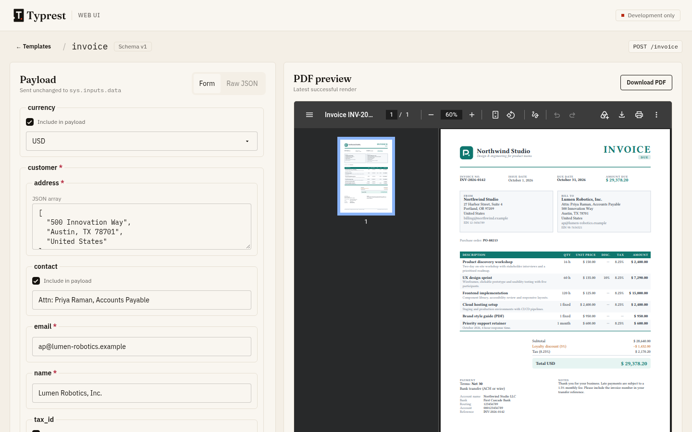

<p align="center">
  <a href="https://typrest.talison.dev">
    <picture>
      <source media="(prefers-color-scheme: dark)" srcset="brand/logos/typrest-logo-horizontal-inverse.svg">
      
    </picture>
  </a>
</p>

<p align="center">
  <strong>Send JSON, get a PDF.</strong><br>
  An HTTP service that renders <a href="https://typst.app/">Typst</a> templates into PDFs, for applications in any language.
</p>

<p align="center">
  <a href="https://github.com/talis-fb/typrest/actions/workflows/ci.yml"></a>
  <a href="https://github.com/talis-fb/typrest/releases"></a>
  <a href="https://github.com/talis-fb/typrest/pkgs/container/typrest"></a>
  <a href="https://typrest.talison.dev/docs/"></a>
  <a href="LICENSE"></a>
</p>

<p align="center">
  <a href="https://typrest.talison.dev">Website</a> ·
  <a href="https://typrest.talison.dev/docs/quick-start/">Quick start</a> ·
  <a href="https://typrest.talison.dev/docs/">Documentation</a> ·
  <a href="https://typrest.talison.dev/examples/">Examples</a>
</p>

---

Design a document once as a Typst template, run Typrest next to your applications, and any of them
can get a finished PDF by posting the document's data as JSON. It is built for invoices, receipts,
reports, letters, certificates, and tickets.

- **One folder per template.** The folder name is the route: `templates/invoice/` answers on
  `/invoice`.
- **Validated payloads.** An optional `schema.yml` rejects bad data with a clear error before the
  template runs.
- **Checked before it serves.** Every template is compiled at startup, so a broken one stops the
  deploy, not a request.
- **Live reload and a Web UI.** Edit a template, fill in a form, and see the PDF beside it.
- **A single binary.** No runtime, no headless browser, no network access at render time.

<p align="center">
  
</p>

## Install

With Docker, this starts Typrest with a small demo project:

```bash
docker run --rm -p 127.0.0.1:8080:8080 ghcr.io/talis-fb/typrest:latest
```

A Linux binary, `cargo install`, and building from source are covered in the
[install guide](https://typrest.talison.dev/docs/install/).

## Quick start

Create a project and start the server:

```bash
typrest init demo
cd demo
typrest serve --watch
```

Then ask for a PDF from another terminal:

```bash
curl -X POST http://127.0.0.1:8080/hello-world \
  -H 'Content-Type: application/json' \
  --data '{"name":"Ada"}' \
  --output hello-world.pdf
```

The template behind that route is `templates/hello-world/main.typ`:

```typst
#let data = json(bytes(sys.inputs.data))

= Hello #data.name
```

Open `http://127.0.0.1:8080/_webui/` to try templates in the browser. The
[quick start](https://typrest.talison.dev/docs/quick-start/) walks through each step.

> [!WARNING]
> Typrest has no authentication. Keep it on a private network and read
> [Run in production](https://typrest.talison.dev/docs/deploy/) before deploying it.

## Documentation

| | |
|---|---|
| [Write templates](https://typrest.talison.dev/docs/templates/) | Layout, shared files, fonts, images, and Typst packages |
| [Validate the data](https://typrest.talison.dev/docs/schemas/) | Describe what each template expects with `schema.yml` |
| [Integrate with your system](https://typrest.talison.dev/docs/integrate/) | Call Typrest from your own code |
| [Run in production](https://typrest.talison.dev/docs/deploy/) | Deploy and secure the service |
| [Reference](https://typrest.talison.dev/docs/reference/cli/) | The CLI, `typrest.toml`, and the HTTP API |
| [Examples](examples/README.md) | Complete projects: invoice, report, resume, certificate, and more |

## Contributing

Contributions are welcome. You need a Rust toolchain, version 1.85 or newer:

```bash
git clone https://github.com/talis-fb/typrest.git
cd typrest
cargo build --locked
cargo test --workspace
```

Before opening a pull request, run the checks that CI runs:

```bash
cargo fmt --all -- --check
cargo clippy --workspace --all-targets -- -D warnings
cargo test --workspace
```

[`CONTRIBUTING.md`](CONTRIBUTING.md) has the workflow, and the [`docs/`](docs/README.md) folder
holds the specifications and architecture notes. See [`ROADMAP.md`](ROADMAP.md) for what is planned,
and report vulnerabilities privately as described in [`SECURITY.md`](SECURITY.md).

## License

Copyright 2026 Talison Fabio. Licensed under the [Apache License, Version 2.0](LICENSE).
